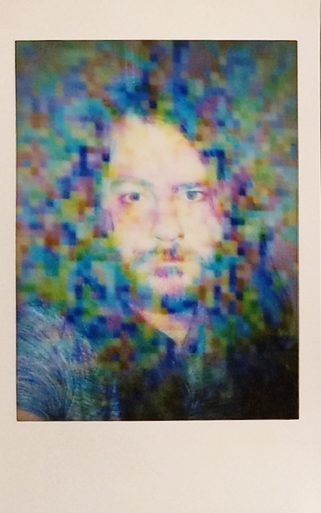

<table>
<tr>
<td width="330" valign="top">

</td>
<td valign="top">

## tgies

*senior software engineer · Omaha, NE*

I've been programming basically my whole life. I specialize in being brought in to figure out what's gone wrong, and to see what's going to break before it does. I really like figuring stuff out and solving problems and doing research and I am pretty good at it I think.

I recently wrote the multi-platform, pure C, no-dependencies version of the [Copy Fail (CVE-2026-31431)](https://copy.fail) exploit proof-of-concept. Besides that, lately I have been working on different audio DSP projects, maintaining an mTLS library that AWS API Gateway documentation recommends, red-teaming, and accidentally inventing a Vocaloid. I run a consultancy, Crash United, LLC, and I'm open to senior IC / staff roles and fixed-scope work.

</td>
</tr>
</table>

### Selected work

| | |
|:--|:--|
| **[klattsch](https://github.com/tgies/klattsch)** &nbsp;`340+ ★` | A parallel-formant speech synthesizer that runs in the browser, built from 1980 DSP papers as a joke. Then it [got loose](https://www.dexerto.com/entertainment/1980s-text-to-speech-app-goes-viral-after-fans-turn-it-into-hatsune-mike-and-daft-punk-machine-3361677/): 9M+ impressions on the launch post, trended on X, and adopted by the Vocaloid scene as an actual instrument. [Try it.](https://tgies.github.io/klattsch/) |
| **[copy-fail-c](https://github.com/tgies/copy-fail-c)** &nbsp;`400+ ★` | Portable C port of CVE-2026-31431 (Copy Fail, a Linux local privilege escalation). Cited in Florian Roth's `signature-base` YARA detection rules, among others. |
| **[client-certificate-auth](https://github.com/tgies/client-certificate-auth)** | Node.js mTLS middleware, [recommended in the AWS API Gateway docs](https://docs.aws.amazon.com/apigateway/latest/developerguide/getting-started-client-side-ssl-authentication.html). 270K+ npm installs, maintained since 2013. |
| **[Nuked-OPL3-fast](https://github.com/tgies/Nuked-OPL3-fast)** | Hand-optimized OPL3 FM-synthesis emulator: 1.4 to 2.2x faster and still bit-exact. Pulled upstream into dosbox-staging, DOSBox-X, 86Box, and more. |
| **[uls](https://github.com/tgies/uls)** | Rust toolkit for FCC ULS license data. |
| **[The GPG Guide 2026](https://leanpub.com/gpg-guide)** | A 376-page guide to modern GnuPG. |

### Also

- 30 years deep in working in embedded, legacy, and other strange systems, AND on the latest most bleeding edge stuff (so basically broken stuff, just two different kinds of broken stuff)
- DevOps stuff
- AI red-teaming
- An embedded IoT product I got running in the field after it had spent four years stuck in failed testing.
- A secret skunkworks project that will change fonts forever imvho
- Tons of "because I can" projects for reasons I can't fully justify
- I make music also. Remind me to put some links here

### Elsewhere

[crashunited.com](https://crashunited.com) &nbsp;·&nbsp; tgies@tgies.net &nbsp;·&nbsp; info@crashunited.com
